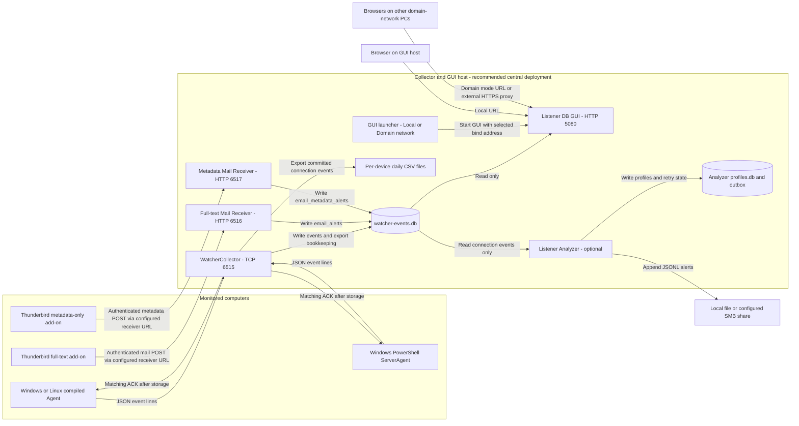
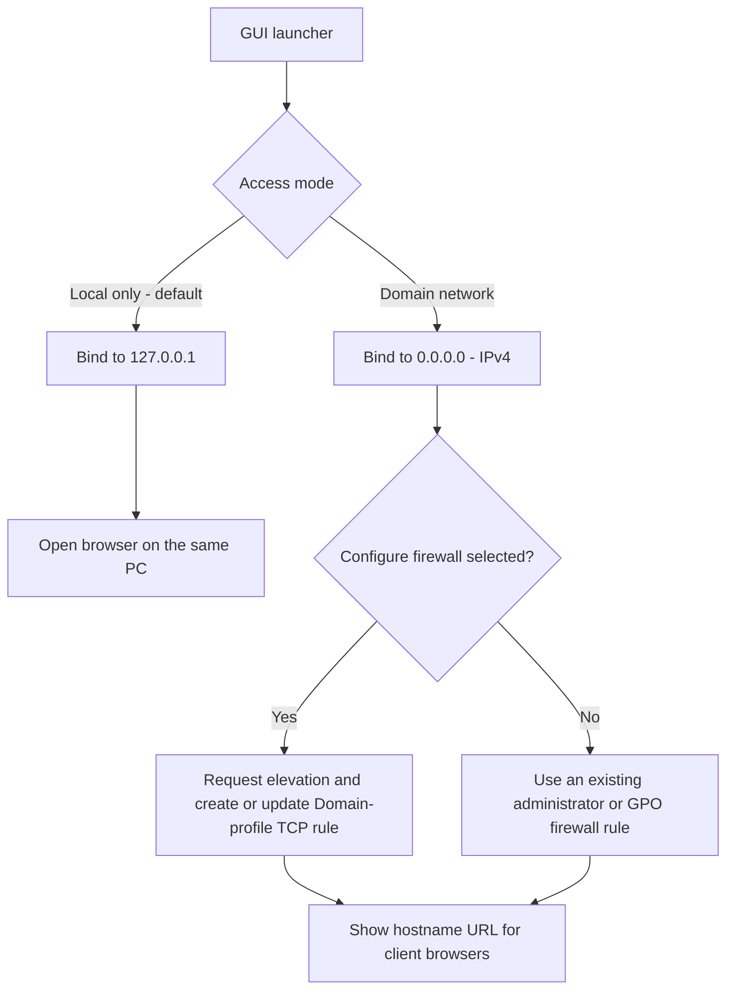
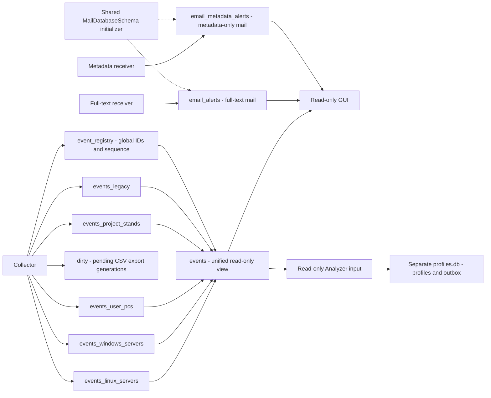
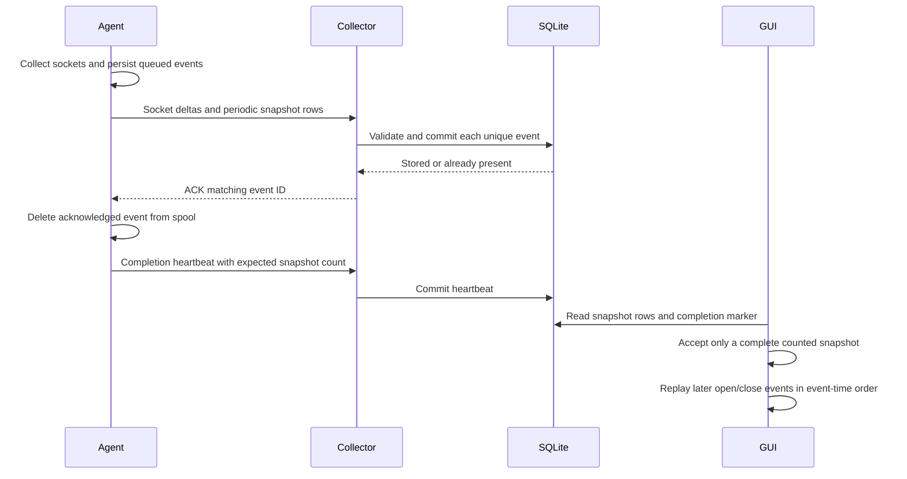

# Listener — system scheme

Updated **19 November 2026**. Describes the current repository, including complete connection snapshots, Last minute captures, heartbeat availability timelines, Agent launch/stop controls, and the local/domain GUI launcher.

## 1. Overall architecture



**Choose one network agent per monitored machine** unless duplicate monitoring is intentional: compiled `Agent` or PowerShell `ServerAgent`. They implement the same Collector event protocol. The ServerAgent is suitable for Windows servers/domain controllers; it collects connection/process metadata, not AD logons or Windows Event Logs.

**Choose the appropriate Thunderbird variant.** The metadata-only add-on does not disable the full-text add-on. Disable the latter if message text must not be collected. Mail is sent to its dedicated receiver, not to the TCP Collector or GUI port.

The diagram shows logical flows. Mail receivers default to loopback; remote Thunderbird clients need a configured reachable receiver URL, normally through an HTTPS reverse proxy. That proxy is external infrastructure, not installed by the launcher.

## 2. Components, ports and access

| Component | Default endpoint / operation | Role |
| --- | --- | --- |
| Compiled Agent | Outbound TCP to the configured Collector, normally port **6515** | Poll TCP connections and optional UDP endpoints; spool and retry events |
| PowerShell ServerAgent | Same outbound Collector protocol | Alternative Windows server agent |
| WatcherCollector | Plain TCP **6515**, all IPv4 interfaces by default | Validate, deduplicate and store events; acknowledge committed storage |
| Full-text Mail Receiver | `http://127.0.0.1:6516/api/mail-alerts` | Bearer-key authenticated full-text mail ingestion |
| Metadata Mail Receiver | `http://127.0.0.1:6517/api/mail-metadata` | Bearer-key authenticated metadata-only ingestion |
| GUI: Local only | `http://127.0.0.1:5080` | Browser access from the GUI host |
| GUI: Domain network | Bind `http://0.0.0.0:5080`; share `http://GUI-HOST.domain:5080` | Browser access from other PCs that can reach the host/port |
| Analyzer | No inbound listener required | Read the event DB, maintain local profiles, append configured alert output |
| Optional alert share | Configured UNC/SMB file path | Domain users can read the generated JSONL file if share/file permissions allow |

Ports are configurable. **6515 is a plain TCP JSON-line protocol, not an HTTP URL.** Set the actual Collector hostname and port during Agent installation; the compiled fallback hostname is a placeholder, not a discovered server.

### GUI launcher modes

Run `Listener_DB_GUI/Launch-Windows.bat`, select the mode, database, port and optional mail-viewing key file, then click **Start GUI**. `Start-Windows.bat` without arguments opens the same selector.



The optional firewall rule is named `Listener-GUI-Domain-TCP-<port>` and permits the selected inbound TCP port on the **Windows Domain network profile**, not Private/Public profiles. It is persistent; choosing Local only still prevents remote GUI access because the server binds only to loopback. Domain profile detection, routing, DNS and managed firewall policy must permit the connection.

**Domain mode enables network reachability, not AD-user authentication.** It does not check visitors' domain membership or configure Windows sign-in. For AD-account-based access, use an authenticated HTTPS reverse proxy. Mail views keep their separate viewing-key requirement; use HTTPS for remote mail viewing.

Only the GUI host needs the database and key files. Client PCs use their browsers; they do not need a database share. Keep the server console open; Ctrl+C stops the GUI. Stop the existing server before changing access mode on the same port.

## 3. Storage scheme

Default shared Windows database:

```text
C:\ProgramData\WatcherCollector\watcher-events.db
```



| Table / store | Contents and identity |
| --- | --- |
| `events` view | Unified read-only connection events, heartbeats and snapshots from all device categories, with stable global `rowid` and `DEVICE_CATEGORY` |
| `events_linux_servers`, `events_windows_servers`, `events_user_pcs`, `events_project_stands`, `events_legacy` | Separate payload tables, each keyed by `EVENT_ID`; process, addresses, ports, state, snapshots and timestamps |
| `event_registry` | Global event identity, category and monotonic sequence; keeps deduplication and reader checkpoints consistent |
| `gui_devices`, `gui_dimensions`, `gui_heartbeats`, `gui_schema` | Collector-maintained device counters, distinct dimensions, indexed heartbeat stamps and read-model version; derived from connection events |
| `dirty` | Export bookkeeping keyed by host and UTC day; tracks CSV generations |
| `email_alerts` | Full-text mail fields, subject, decoded inline text/MIME parts, visible recipients, attachment filenames and delivery identifiers |
| `email_metadata_alerts` | Message date, sender, recipients, attachment flag and filenames, plus delivery/deduplication identifiers and receipt time; no subject/body columns |
| Agent spool | Local pending JSON event files; each is removed only after a matching Collector ACK |
| Thunderbird queue | Separate IndexedDB queue for each add-on variant; pending payloads are retained until receiver acknowledgment |
| Analyzer `profiles.db` | Separate local database in `state_directory`: device/destination/connection/UDP profiles, day histories, cooldowns, source cursor metadata and alert outbox |
| CSV / JSONL | Collector daily per-device CSV exports; optional Analyzer alert JSONL output |

The Collector and **both receivers** initialize both mail tables using `Shared/MailDatabaseSchema.cs`. The Collector additionally initializes/migrates the connection partitions, `event_registry`, the `events` view and `dirty`. A receiver can create the database/mail tables before the Collector starts. The GUI does not create or migrate tables and opens its database read-only. The Analyzer writes only its separate state/output, not the source event database.

Mail alerts and connection events have separate identities; there is no automatic foreign-key relationship joining a mail `client_label` to a monitored host. Use consistent labels operationally if you want to recognize the same PC in both views.

The previous metadata receiver defaulted to `C:\ProgramData\WatcherMailMetadata\mail-metadata.db`. Existing standalone metadata databases are **not automatically merged or moved**. Set matching custom database paths on receiver and GUI when retaining one, or use the new shared default for new data.

Keep the live SQLite database near its writers/readers on the server. Browser access does not require exposing SQLite over SMB. Back up stopped databases, or use a SQLite-aware backup that includes consistent WAL state; copying only a busy `.db` file is not a reliable backup.

## 4. Connection collection and GUI views

Compiled Agent defaults: socket polling every **5 seconds**, heartbeat/full snapshot every **60 seconds**. ServerAgent intervals are configurable. GUI overview refresh: **10 seconds** while its page is visible. Collector CSV export example: **10 seconds**.

| Event | Meaning |
| --- | --- |
| `ACTIVE_AT_START`, `UDP_ENDPOINT_AT_START` | Sockets observed when the agent establishes its initial baseline |
| `TCP_CONNECTED`, `UDP_ENDPOINT_OPENED` | A socket newly observed by polling |
| `TCP_DISCONNECTED`, `UDP_ENDPOINT_CLOSED` | A previously observed socket is no longer observed |
| `TCP_SNAPSHOT`, `UDP_SNAPSHOT` | Socket rows in a periodic complete snapshot |
| `HEARTBEAT` with `STATE=SNAPSHOT_COMPLETE:<count>` | Declares the expected socket-row count for that snapshot ID; zero is a valid empty snapshot |



A partially delivered snapshot is not treated as a complete device state. An empty completed snapshot clears old sockets after a restart. The Collector's observed peer IP can differ from the reported local IP because of NAT or loopback; the GUI labels them separately. UDP bindings may have no remote peer.

### Overview tab

Shows observed local IPs, latest reported TCP connections/UDP endpoints, and a 60-minute chart of **new TCP connection events per minute**, including average and peak. Startup and periodic snapshot rows do not inflate that rate. The current chart minute is partial; zero recorded opens can also mean missing reports.

The current-connections table is reconstructed from complete snapshots and later deltas. Reports older than two minutes, incomplete new snapshots and large future clock differences are labelled. It is the latest reported state, not a direct instantaneous probe.

### Last minute tab

A frozen frame of the 60 seconds ending at the capture timestamp. Includes long-running connections present at the latest report and connections observed opening, closing or in snapshots during that minute. Repeated observations of the same socket identity appear in one row.

The table shows process/PID, local/peer IPs and ports, last evidence time, and present/closed/absent/unknown status. Paging reuses the capture timestamp and database row watermark, so incoming or late/backdated records do not shift the frame. **Capture latest minute** creates a new frame. It is an inspection view, not a permanently stored screenshot/archive.

Polling can miss very short-lived connections. Older agents without complete snapshots can show recent observations, but their current state remains unknown.

### Online history page

The Overview IP box is blue when a valid agent heartbeat is newer than the configured grace interval (default 120 seconds), red when reports have expired, and grey if there is no usable heartbeat history. It shows the current online period or offline/last-online duration. **Show online graph** opens the daily/hourly timeline for that device.

The GUI derives online periods by merging intervals from each heartbeat timestamp through heartbeat plus grace, clipped to the current time. Historical gaps after the first retained report are offline/no-report periods; earlier history is unknown. Delayed reports fill history without proving current availability, and future timestamps are ignored. This is estimated reporting availability, not confirmed power state or OS uptime.

The graph defaults to seven days in the browser time zone, supports up to 90 days per view and accounts for daylight-saving day lengths. It shows daily online totals and exact period times, and refreshes every ten seconds. Computation reads the existing `events` table; no new database tables or agent protocol changes are required.

## 5. Mail collection variants

| Field / behavior | Full-text add-on | Metadata-only add-on |
| --- | --- | --- |
| Message date and sender | Yes | Yes |
| Receiver | To/Cc, visible Bcc and additional available delivery/account fields | Deduplicated To/Cc/visible Bcc |
| Has attachments / filenames | Filenames; presence can be derived | Explicit boolean plus filenames |
| Subject | Yes | Excluded |
| Inline message text / MIME text parts | Yes | Excluded |
| Attachment file contents | Excluded | Excluded |
| Receiver endpoint | `/api/mail-alerts`, port 6516 | `/api/mail-metadata`, port 6517 |
| Stored in | `email_alerts` | `email_metadata_alerts` |
| Thunderbird add-on ID | `listener-mail-alerts@tea-gd.local` | `listener-mail-metadata@tea-gd.local` |

Both require Thunderbird **140+**, explicit account/domain configuration and enabling collection. They report newly received external-domain mail, with no automatic historical inbox scan. Hidden Bcc or SMTP envelope recipients not exposed by Thunderbird cannot be recovered.

Metadata-only collection excludes subjects, bodies and attachment contents from its queued/transmitted/stored payload. The receiver rejects unknown payload fields. Operational client/account identifiers, deduplication keys and receipt timestamps remain for reliable delivery. The original email still exists in Thunderbird's normal mail storage.

In the GUI, open **Mail alerts**, enter the separate mail viewing key, and select **Full-text mail** or **Metadata only**. Receiver authentication keys and GUI viewing keys serve different purposes. Use `-InitializeKey` on receiver startup for first-time protected key creation; existing keys are preserved.

## 6. Install, update and operate

1. Back up existing databases/configuration and build the current repository with .NET 10 SDK; `Build-Windows-All.bat` also requires Python 3 to package both Thunderbird variants.
2. Upgrade/start the **Collector first**. Older Collectors reject the new snapshot event types. Check the actual listening port and optional agent IP allowlist.
3. Install/update the chosen network agent on each monitored PC, supplying the actual Collector hostname/port. Avoid running both compiled Agent and ServerAgent on one PC unintentionally.
4. Build/start the required mail receiver and configure its matching Thunderbird add-on. Disable the full-text add-on when selecting metadata-only collection.
5. Rebuild/start the GUI using the new launcher. Choose Local only or Domain network; browser users use the displayed server URL. Configure a separate viewing key if mail access is required.
6. Start the optional Analyzer against the same source database and its own local state directory. Configure a local or shared alert file if needed; it is not an automatic messenger/email sender.

| Operation | Control / effect |
| --- | --- |
| Agent Install / Update | Repairs legacy config permissions/read-only flags; stages and replaces files; preserves custom spool paths, settings and unsent events |
| Agent Launch Agent | Starts the existing startup task with saved configuration; avoids a duplicate installed process |
| Agent Stop Agent | Stops the installed process/current task run; retains task registration, configuration and queue; startup can run again after reboot |
| Agent uninstall | Explicit separate action; local data is preserved unless deletion is selected |
| Collector start/stop | Installer's Start Service / Stop Service controls the Windows service |
| GUI start | Launcher opens a separate server console with chosen mode/port/database |
| GUI stop / mode change | Ctrl+C in the server console, then relaunch with the desired mode |

Agent startup task: `Watcher-Connection-Agent`. ServerAgent task: `Watcher-Server-Agent`. Collector service: `WatcherCollector`.

Default Agent configuration/spool location: `C:\ProgramData\WatcherAgent`. Default ServerAgent data: `C:\ProgramData\WatcherServerAgent`. Collector configuration, database and log: `C:\ProgramData\WatcherCollector`. Full-text receiver key default: `C:\ProgramData\WatcherMailReceiver\receiver.key`; metadata receiver key default: `C:\ProgramData\WatcherMailMetadata\receiver.key`.

## 7. Quick troubleshooting map

| Symptom | First checks |
| --- | --- |
| Old agents work, a new PC is missing | Saved Collector hostname/port, scheduled task/process, TCP connectivity, growing spool, Collector `BLOCKED`/`REJECTED` log entries and IP allowlist |
| `agent.json` access denied during update | Rebuild/run the current installer elevated; use Install / Update to repair ordinary legacy ACL/read-only cases without deleting ProgramData |
| Current connections unavailable | Confirm the agent sends complete snapshots and Collector supports their event types; inspect freshness/incomplete markers |
| Remote browser cannot open GUI | Domain mode selected, displayed hostname resolves, correct port, active Domain network profile and firewall/GPO/routing; stop an old local-only GUI before switching modes |
| Mail is missing | Correct receiver variant/URL, matching receiver key, enabled accounts/domain filter, queue status and matching database path; GUI mail viewing key configured |
| No Analyzer alerts | Analyzer running, baseline/warm-up and age/cooldown rules, valid source DB, output path/share permissions and local outbox |

Component guides: [Agent](Agent/README.md), [Linux Agent](Agent/README-linux.md), [ServerAgent](ServerAgent/README.md), [Collector](Collector/README.md), [GUI](Listener_DB_GUI/README.md), [Analyzer](Listener_Analyzer/README.md), [full-text mail](Listener_MailReceiver/README.md), [metadata-only mail](Listener_MailReceiver_Metadata/README.md).

## Device storage categories

Agents tag events with the device type selected during installation. The Collector stores payloads in separate category tables and exposes the unified `events` view to existing readers. Existing data remains in `events_legacy`, with original rowids preserved in `event_registry`. Mail retains its separate full-text and metadata tables. See [storage choices, installation and migration](DEVICE-STORAGE.md).

## GUI read performance

The Collector maintains derived `gui_*` tables in the event transaction. The read-only GUI uses device summaries and indexed heartbeat stamps, caches sessions until heartbeat data changes, and initially scopes history to the latest recorded UTC day. The connection comparison report is loaded on request. See [performance deployment and measurements](Listener_DB_GUI/PERFORMANCE.md).

## Connection-name annotations

The GUI displays agent-reported source/destination names from existing event fields. Missing source names use the monitored device identity; missing peer names use bounded background reverse DNS on the GUI server, with caching and timeouts. Current DNS annotations do not change stored events or frozen capture data. See [GUI connection names](Listener_DB_GUI/README.md#connection-names).

## Windows agent task and notebook power

The compiled-agent installer creates/replaces an explicit SYSTEM startup task that permits battery startup and unplugging, has no execution time limit, and retries failures. Apply the policy to older installations using **Install / Update** in the rebuilt installer. Configuration and queued events are preserved. The separate PowerShell ServerAgent already uses equivalent battery/runtime settings. See [notebook deployment and verification](Agent/README.md#notebooks-run-on-battery-power).

## Device-folder navigation

The GUI sidebar groups devices into Win Server, Linux Server, User PCs and Project Stand, using the newest categorized event for each device (event-time order, global sequence to break ties). Legacy-only devices appear in Unclassified. Folder navigation does not move historical records or split a device's combined history. See [device folders](Listener_DB_GUI/README.md#device-folders).

## Offline replay and orange timeline

Agents retain unsent events locally, replay original timestamps/IDs after reconnection and delete files only after matching durable Collector ACKs. Slow replay yields between acknowledged events so collection can resume. The Collector maintains `gui_heartbeat_delivery(host,stamp_ms,received_ms)` as derived receipt history (GUI schema marker 2), using the earliest receipt for duplicate heartbeat stamps. The GUI colors working intervals orange when their heartbeat delivery delay exceeds its threshold; blue represents timely reports, red missing heartbeat evidence. Orange is reconstructed after delivery and does not identify the exact cause of a connectivity interruption. See [deployment, thresholds and limits](Listener_DB_GUI/README.md#orange-working-periods-after-offline-replay).

## Minute network/process correlation

Agents send `NETWORK_CONTEXT`, `PROCESS_CONTEXT` and a final `CONTEXT_COMPLETE` count marker through their existing durable spool. The Collector routes these into `device_network_communications`, `device_process_snapshots` and `device_context_snapshots` in the same transaction as global event-ID reservation. These payloads do not enter the connection-events view, CSV exports or Analyzer input. Global sequence gaps are retained. The online-history page's context panel reads complete samples by device/day and correlates adapters with process/service observations by snapshot ID. Deploy Collector before agents. See [field and coverage documentation](Listener_DB_GUI/README.md#device-network-communications-and-running-processes).

## Daily timeline UI

The GUI defaults to three days with configurable rows per page and a selected date range. Each daily activity graph includes a timezone-aligned network-sample strip, using bounded two-minute estimates rather than carrying stale adapter state across gaps. Range totals include all selected dates. A device-specific empty analysis destination is linked beside the graph button. This is a GUI-only change; see [timeline navigation](Listener_DB_GUI/README.md#daily-timeline-navigation-and-network-strips).

## VPN upload pipelining

The first event may include `request_pipeline: true`. Only after durable storage does an updated Collector respond with `ACK <id> PIPELINE64`. Agents then send at most 64 events or 128 KiB in flight, using the existing per-event ACKs for file deletion. Legacy peers retain sequential behavior. Collector read-ahead and ACK writes use separate stream paths to support queued input safely. No database schema change is needed. See [deployment and backlog verification](Agent/README.md#vpn-backlog-pipelined-delivery).

## Linux server deployment

The Collector has an opt-in `BuildForLinux=true` self-contained amd64 publish and a dedicated-user systemd unit. The Agent uses its Debian 12/13 amd64 package and root systemd unit. Both single-file services use writable extraction paths inside their data directories. Default uninstall instructions preserve the database or unsent spool; full data deletion is separate. See [Linux deployment and removal](LINUX-DEPLOYMENT.md).
