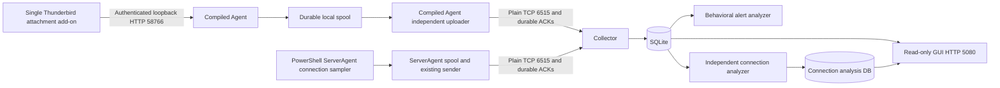

# Listener architecture and deployment scheme

Listener collects connection/network/process observations from devices and attachment-only mail metadata from Thunderbird. The Collector stores them in SQLite; the GUI reads that database. Update the Collector before agents or add-ons that send new event types.

## Components and paths

The compiled Agent runs on Windows/Linux. Its local mail endpoint is disabled until `mail_token` is configured; it binds only to `127.0.0.1`. ServerAgent remains a separate connection/network sampler and does not supply this mail bridge. Collector TCP is unencrypted and unauthenticated; deploy on a restricted management LAN or protected VPN with firewall/CIDR restrictions. Agent identity is reported, not authenticated.

## Connection storage and offline delivery

The installer selects Linux servers, Windows servers, User PCs or Project Stands. Payloads go to `events_linux_servers`, `events_windows_servers`, `events_user_pcs` or `events_project_stands`; old unclassified records remain in `events_legacy`. The unified read-only `events` view retains global rowids from `event_registry`. Category changes affect future records and do not split device history. `dirty` tracks per-device/day CSV export generations.

Agents poll sockets, record open/close events and send complete TCP/UDP snapshots on each heartbeat (normally one minute). A count marker prevents partial socket snapshots from becoming authoritative. UDP bindings may have no known remote endpoint. Historical observations and reported active sockets are separate views; polling can miss brief activity.

Spool files survive network outages and are deleted only after matching durable Collector ACKs. Original timestamps and IDs survive replay. The first event can negotiate `PIPELINE64`, enabling up to 64 events/128 KiB in flight; legacy peers retain sequential behavior. The compiled Windows/Linux Agent uploads in a separate worker, immediately continuing after each bounded 1,000-file pass while sampling runs independently. Failed sends back off five seconds; an idle worker wakes on publication or rescans after one second. A process-lifetime spool lock prevents competing compiled Agent instances. The separate PowerShell ServerAgent still yields between groups after approximately five seconds. The compiled Agent spool is capped at 50,000 events; a full spool preserves pending files but stops new collection.

## Derived views and network context

`gui_devices`, `gui_dimensions`, `gui_heartbeats` and `gui_heartbeat_delivery` accelerate device summaries and availability. Blue estimates working time with timely heartbeats; orange reconstructs working time from delayed delivery; red means no recent heartbeat evidence. Receipt delay cannot identify whether the cause was internet, VPN or Collector failure. Before buffered reports arrive, the server cannot know the device was working. Time-zone/DST rules apply to daily graphs.

Minute samples also populate `device_network_communications`, `device_process_snapshots` and `device_context_snapshots`. Complete samples correlate active adapters with running processes/services by device and snapshot ID. VPN-name matches are hints, not proof of an active tunnel or application route. No process command lines or file/message contents are sampled.

The GUI sidebar has expandable device-category folders and Unclassified. Daily history defaults to three days, with range selection/paging and smaller network strips using bounded sample intervals. An empty device analysis page is linked beside Show online graph. The GUI supports local/domain bind modes, but network exposure alone does not authenticate domain users.

## One attachment mail pipeline

Only `listener-mail-attachments@tea-gd.local` is packaged. Incoming messages without attachments are ignored. Incoming messages with attachments report Thunderbird notification time, sender, visible recipients, attachment names/formats/sizes and a delivery GUID. No subject, body or attachment contents are collected. The local Agent authenticates requests and flushes metadata into its spool before returning HTTP acceptance; the Collector acknowledges only after database commit.

`mail_information` is the only mail table. Attachment metadata is JSON with name, format and nullable size in bytes. On upgrade, supported attachment metadata from the two legacy mail tables is migrated transactionally and those tables are dropped. Historical arrival dates and sizes that were never recorded remain unknown. Non-attachment records and old subject/body fields are intentionally removed. Connection/process/network tables are preserved. Old receivers and old add-ons must be stopped/removed from deployed machines and GPO before upgrading; deleting repository sources does not uninstall deployed software.

The GUI mail page remains read-only and requires its separate viewing key. The Agent's local mail token does not grant GUI viewing access. The full migration/setup and field limits are in [Thunderbird attachment mail](Thunderbird_Attachments/README.md).

## Installation and updates

- Windows: build current sources using `Build-Windows-All.bat`; update Collector first, then Agent with Install / Update, then GUI and the single add-on. Agent updates retain configuration/spool. The SYSTEM startup task runs on battery, permits unplugging, has no 72-hour limit and starts without a user session.
- Linux: follow [Collector and Agent deployment/removal](LINUX-DEPLOYMENT.md). Collector has an opt-in self-contained amd64 build/systemd unit; Agents have Debian 12/13 amd64 packages. Bundle extraction uses writable state directories.
- SQLite: keep it near its writers/readers, not on a network share. Stop writers for filesystem backups, or use SQLite-aware backup. Back up before the destructive legacy-mail migration. GUI access from another server needs an appropriate data-access design.

## Component guides

[Agent](Agent/README.md) · [Linux deployment](LINUX-DEPLOYMENT.md) · [ServerAgent](ServerAgent/README.md) · [Collector](Collector/README.md) · [GUI](Listener_DB_GUI/README.md) · [Analyzer](Listener_Analyzer/README.md) · [Device storage](DEVICE-STORAGE.md) · [Single mail add-on](Thunderbird_Attachments/README.md)

## Independent incoming/outgoing analysis

`Listener_ConnectionAnalyzer` reads the main `events` view read-only and writes its own
`connection-analysis.db` (`analysis_connections`, `analysis_meta`). The GUI reads this
second DB using `WATCHER_ANALYSIS_DB_PATH`; **It's time to analyze** opens its Incoming,
Outgoing and Unknown views, with first-seen connections/peers for a selected day/zone.
TCP direction metadata is estimated at the Agent using local listeners and preserved
by the updated Collector; older/ambiguous observations remain Unknown. Original event
time, opposite-direction history and late replay determine novelty. This is separate
from the existing alert analyzer. See [deployment and semantics](Listener_ConnectionAnalyzer/README.md).
